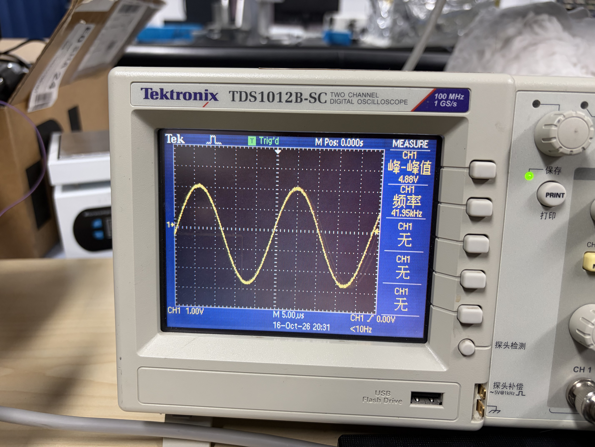
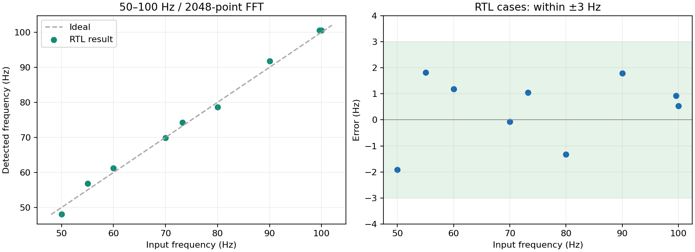

# 主板 Chirp 发射与 RX / FFT 实验记录

2026-10-17 更新：main 已接入25–500 Hz、8192点FFT和峰值检测，使用165 MHz系统时钟。请看 [main操作说明](02_RTL/V0/README_main_2026-10-17.md) 与 [验证报告](verification/FFT/Main_20261017/report.html)。下文保留10月16日两个独立实验的记录。

日期：2026-10-16（Asia/Shanghai）；2026-10-17 更新为单 .qpf、多 Revision 入口  
工作工程：`E:\Document_HH\Course\26FA\450code\15_UsMimoTestBench`  
器件：Intel Cyclone V **5CEFA7F23I7**  
本文件集中记录本轮实验的目标、方案变化、接线、代码位置、验证证据和实板反馈。下文文件链接相对于本 README 所在的工程根目录。

> **目录已整理：** 当前只用 [Chirp / FFT 两个入口](02_RTL/V0/Simulation/README.md)。参数在各自 `settings.json`，功能模块和两个可综合顶层统一到 `SourceCode`，与原顶层平级。下文历史结果保留；旧入口和重复源码已从工作目录移除，存于 [整理前归档（已归档）](verification/Archive/README.md)。

> **结果目录已分类：** 当前实验记录在 `verification/Chirp`、`verification/FFT`、`verification/Measurements`；汇报素材在 `verification/Figures`；其余旧版本和失败重跑数据已集中到 [历史归档索引](verification/Archive/README.md)。

## 1. 当前结论与使用入口

| 实验 | 最终配置 | 已有结果 | 现在使用的文件 |
|---|---|---|---|
| 实验 1：主板 TX 接示波器 | 38–42 kHz Chirp，20 ms，每 200 ms 发一次；主 PLL / DAC 165 MHz | 编译及 36 项时序检查通过；用户已烧录成功并看到正弦波，反馈“实验 1 弄好了” | [ChirpTxScope40k20ms.sof](02_RTL/V0/output_chirp_scope_40k20ms/ChirpTxScope40k20ms.sof) |
| 实验 2：外部发生器接主板 RX，FPGA 做 FFT | 输入 50–100 Hz；原 ADC 采样率保持不变；CIC 滤波 /128；2048 点 FFT，约 228.78 ms | 数字链路、完整顶层采集、串口解析、68 项时序检查通过；用户反馈实板结果符合预期，实测日志见第 7 节 | [RxFftLowFreq50to100Hz.sof](02_RTL/V0/output_rx_fft_lowfreq/RxFftLowFreq50to100Hz.sof) + [RxFftLowFreqMonitor.exe](02_RTL/V0/Tools/RxFftLowFreqMonitor/RxFftLowFreqMonitor.exe) |

**统一从 [UsMimoTestBench.qpf](02_RTL/V0/UsMimoTestBench.qpf) 打开，通过 Project → Revisions → Set Current 选择 ChirpTxScope40k20ms 或 RxFftLowFreq50to100Hz。两个实验使用两个独立固件。** FPGA 当前只运行最近下载的那一个：实验 1 只输出 TX；实验 2 使用外部输入，停用 TX。当前没有把二者合并成一份“TX 同时发 Chirp、RX 同时做 FFT”的固件。

`.qpf` 用来打开 Quartus 工程；`.sof` 才是 Programmer 下载到 FPGA 的文件；testbench 用 Questa 运行，不能直接烧录。此次下载为 SRAM 配置，断电后需重新下载，没有改写板上的配置 Flash。

## 2. 思路如何变化，为什么这样调整

| 阶段 | 当时目的 / 观察 | 方案变化与保留的结论 |
|---|---|---|
| 原 40 kHz 工程 → 200 kHz RTL 检查 | 以前在上位机改成 200 kHz 后接收不到信号，怀疑 Chirp 生成 | 检查 190–210 kHz、80 ms TX / 84 ms RX。数字核可以生成目标 Chirp；这不等于证明换能器、模拟前端及声学路径已能正常工作，也未证明生成逻辑就是以前失败的原因。 |
| 完整逐位 UART 长仿真 → 分层验证 | 完整 Intel 浮点 IP 加长帧 UART 仿真耗时很长，曾中断 | 按用户要求停止长 UART 逐位仿真，保留部分结果，改用短 UART 测试 + 长窗口控制、缓存、打包检查。未把未完成的长仿真记为整链路通过。 |
| 减少生产代码改动 | 用户要求尽量保持原版，只调整 Chirp 参数和窗口 | 恢复原 165 MHz 主时钟、ADC 采样节拍和 2 Mbaud UART；中间方案中的 96 MHz / 1 MS/s 不作为当前上板配置。原版 ADC 驱动的严格初始化时序问题另行记录，没有把它说成 200 kHz 失败的已证实原因。 |
| 独立 Kaiser4 + FFT，再加功率谱和峰值 | 希望 FPGA 能找出输入信号的主要频率 | 先独立验证约 80 ms、91667 点输入、131072 点 FFT；再加入 `Re²+Im²` 与范围内最大峰搜索。该阶段的独立资源工程没有直接连主板引脚。 |
| 实验 1 缩为 40 kHz / 20 ms | 先确认主板实际能输出波形，方便示波器操作 | 建立自动重复发射的独立顶层，38–42 kHz，20 ms；保留 165 MHz，通过约束、输出寄存器与复位扇出处理满足时序。用户已完成上板观察。 |
| 实验 2 从设想的 TX→RX 回接改为外部发生器 | 先单独验证 ADC→FFT，避免把 TX、幅度匹配和 RX 问题混在一起 | 首先准备外部 40 kHz 版本；随后按用户要求改用 100 Hz 正弦波。实验 1 的发射频率和时长保持不变。 |
| 100 Hz / 20 ms 版本发现“只有两档” | 60/70/80 Hz 常显示 69.94 Hz；90/100 Hz 常显示 104.90 Hz | 20 ms 数据补零到 32768 点后，频格仍约 34.97 Hz；程序只报告整数峰值 bin，无法满足几 Hz 的误差目标。 |
| 最终：50–100 Hz 专用低频版本 | 用户明确只需覆盖 50–100 Hz，目标误差在几个 Hz 内 | 原 ADC 采样不变，增加 3 阶 CIC 低通和 /128 抽取，延长观察到约 229 ms；使用 2048 点 FFT，频格降为 4.371 Hz，验证目标为 ±3 Hz。 |

阶段性证据入口：[原 165 MHz 的 200 kHz 检查（已归档）](verification/Archive/README.md)、[独立整段 80 ms FFT（已归档）](verification/Archive/README.md)、[独立功率谱与峰值（已归档）](verification/Archive/README.md)。

原 165 MHz / 200 kHz 分层测试记录过 96244 个 RX 样本、0 个打包样本不匹配，但同时记录 **33 次 ADC 配置 SDI setup 违规，严格时序检查未全通过**。见[原始检查结果（已归档）](verification/Archive/README.md)。当前独立上板实验采用另写的 ADC SPI 驱动，并通过相应接口时序验证；两类结论不可混用。

## 3. 板子、电源、USB 与 JTAG 接线

这两个实验都只用主板。主板的 TX/RX 是模拟信号输出/输入；UART 的 TXD/RXD 是数字串口信号，两者不是同一个接口。

| 主板位置 | 功能 | 本次连接 |
|---|---|---|
| J1，USB-C | 5 V 输入 + CH343G USB 串口 | 用带数据功能的 USB-C 线连接电脑，主板 S1 打开 |
| P2，PGM，6 针 | JTAG 下载 | 经信号对应正确的转接线接 USB-Blaster |
| P4，TX_OUT，BNC | 主板模拟输出 | 实验 1 接示波器 CH1 |
| P5，RX_IN，BNC | 主板模拟输入 | 实验 2 接信号发生器输出 |
| P1，5V Out | 设计中的对外电源输出 | 本次不使用；主板从 J1 供电 |

### 3.1 两条 USB 线各自做什么

```text
电脑 USB ── USB-Blaster ── JTAG 转接线 ── 主板 P2      下载 .sof
电脑 USB ── USB-C 数据线 ─────────────── 主板 J1      主板供电 + COM 串口
                                                   S1：ON
```

USB-Blaster 不负责给整块主板供电。主板 J1 的 USB 串口也不能直接替代 JTAG 下载器。

### 3.2 主板 P2 与 USB-Blaster 10 针的对应

按原理图针号、信号名连接；不能把两边针号按 1→1、2→2 对接，也不能仅凭线的颜色判断。

| 主板 P2 针号 | 信号 | USB-Blaster 针号 |
|---:|---|---:|
| 1 | 3V3_PGM，目标板电压参考 Vref | 4 |
| 2 | TCK | 1 |
| 3 | TDO | 3 |
| 4 | TDI | 9 |
| 5 | TMS | 5 |
| 6 | GND | 2 或 10 |

P2 有 6 个电气针脚，连接器另外的固定焊脚不应混进这 6 个针号中。测主板 P2-1 对 P2-6 约 **3.2–3.3 V** 是电压参考的正常量级，不要求这里等于 USB 输入的 5 V。插拔、改线前断开供电，导通检查在断电状态下做。

本次 JTAG 排查记录：电脑能识别 USB-Blaster，但最初读不到 FPGA；用户去掉中间“10 转 10”的连接后，Auto Detect 成功，随后下载显示 **100% Successful**。这表明此前的连接路径是重点排查对象，不能据此确定具体哪一根线内部断路。未执行用户提供的旧驱动包或其中的其他安装程序。

Auto Detect 若出现共享 JTAG ID 的型号选择框，选择 **5CEFA7**，不要选 5CEBA7 或工程样片 5CEFA7ES。

接线资料：[主板/前端板接线说明](HARDWARE_WIRING_NOTES.txt)、[接线图](HARDWARE_WIRING_OVERVIEW.drawio)。本次主板实验不接前端功放和换能器；前端 P2 的差分功放输出也不是主板 P2 JTAG。

## 4. 实验 1：Chirp generation → 主板 TX → 示波器

```text
FPGA 自动触发 → 原 Chirp 运算核 → DAC → 主板 P4 TX_OUT ── BNC ── 示波器 CH1
```

### 4.1 配置与文件

| 项目 | 值 |
|---|---|
| 起止频率 | 38 → 42 kHz |
| 每次发射时长 | 20 ms |
| 重复间隔 | 起点到起点 200 ms，即每秒 5 次 |
| 数字幅度 | 满量程的 25%，实际 BNC 电压由模拟电路与负载决定 |
| 时钟 | 主板 100 MHz 参考输入 → PLL 165 MHz；DAC 保持 165 MHz 更新时钟 |
| 启动 | 下载后自动运行，PLL 锁定后约 100 ms 开始；不需要 03_SW 或 UART Trigger |
| RX / FFT | 本固件停用 |

- 打开工程：[UsMimoTestBench.qpf，选择 ChirpTxScope40k20ms Revision](02_RTL/V0/UsMimoTestBench.qpf)。
- 下载文件：[ChirpTxScope40k20ms.sof](02_RTL/V0/output_chirp_scope_40k20ms/ChirpTxScope40k20ms.sof)。
- 详细操作：[ChirpTxScope40k20ms_README.txt](02_RTL/V0/ChirpTxScope40k20ms_README.txt)。

### 4.2 下载与示波器操作

1. 主板供电，S1 打开；JTAG 下载线接好。
2. Quartus → Tools → Programmer → Hardware Setup 选择 USB-Blaster；Mode 选择 JTAG。
3. Auto Detect 后在 FPGA 行使用 Change File 选择上述实验 1 `.sof`；勾 Program/Configure，点 Start，等待 100% Successful。
4. 主板 P4 TX_OUT 通过 BNC 接示波器 CH1；普通探头的尖端接信号、地接主板地/BNC 外壳。
5. 本次示波器为 Tektronix TDS1012B-SC。开启 CH1、关闭不需要的 Math/CH2，DC 耦合，RUN；先尝试 1 V/div。该型号通道输入为固定 1 MΩ；普通直连 BNC 选探头倍率 1X，使用 10X 探头则示波器也设 10X。
6. 用约 5 ms/div 看 20 ms 波包，用约 20 ms/div 看 200 ms 重复间隔；看波包包络时可用 Peak Detect。
7. 用 5–10 µs/div 看局部正弦。CH1 上升沿触发，电平在波形中间；若触发位置在波包内跳动，可设置约 50 ms Holdoff。
8. 判断扫频，要比较波包开始、中间、末尾的局部频率。理论上约 38、40、42 kHz，对应周期约 26.3、25.0、23.8 µs。

该示波器记录长度有限；不要把低采样率抓到的整段长窗口停止后，仅靠放大显示就当作高采样率的局部频率测量。比较局部周期时应让示波器按合适时基重新采集。

### 4.3 已有结果

- 控制仿真通过；真实 Intel Chirp 数值核在 20 ms 内的 2001 个检查点通过，最大 DAC 码差 **2**，输出码范围 **6144–10240**。这是数值检查点和控制测试，不等同于连续 20 ms 的完整模拟电路仿真。
- 编译与 **36 项时序检查**通过；最差裕量 **+0.053 ns**，DAC 外部 setup 最小裕量 **+0.868 ns**。
- 用户已成功下载，并提交示波器照片：局部频率显示约 **41.95 kHz**、屏幕 Vpp 读数 **4.88 V**。幅度读数需结合探头倍率和负载理解，不作为校准后的输出电压指标。
- 用户确认“实验 1 弄好了”。照片能证明当时存在约 42 kHz 的模拟正弦输出；单张照片本身不能独立证明整段 38→42 kHz 扫频曲线。



证据：[编译与时序检查](02_RTL/V0/output_chirp_scope_40k20ms/build_checks.json)、[控制和数值检查](verification/Chirp/tests/checks.json)。

## 5. 实验 2：外部正弦输入 → FPGA FFT → 电脑显示

### 5.1 连线和数据流

```text
信号发生器 OUT ── BNC ── 主板 P5 RX_IN
                            │
                 主板 RX 模拟前端（滤波旁路、Div8）
                            │
                         ADC
                            │ SPI
                         FPGA
                            │
             CIC 低通滤波 /128 → 2048点帧缓存
                            │
             减去帧平均值 → Kaiser β=4 → FFT
                            │
                功率谱 Re²+Im² → 峰值 bin
                            │ UART，2 Mbaud / 8N1
主板 CH343G ── J1 USB-C ── 电脑 COM 口 ── RxFftLowFreqMonitor.exe
```

本实验的输入来自外部发生器，不使用实验 1 的 TX。没有接前端板，没有模拟或测量超声传播、反射、混频差频或距离。

### 5.2 推荐操作顺序

1. 下载 [RxFftLowFreq50to100Hz.sof](02_RTL/V0/output_rx_fft_lowfreq/RxFftLowFreq50to100Hz.sof)，等待 100% Successful。需要重编译时打开 [UsMimoTestBench.qpf，选择 RxFftLowFreq50to100Hz Revision](02_RTL/V0/UsMimoTestBench.qpf)。
2. 发生器设连续正弦、先用 100 Hz、0 V 偏置、100 mVpp 起步、负载设置 High-Z，开启输出。若调整幅度，以不过载且能稳定检测为准。
3. 发生器输出接主板 P5 RX_IN，BNC 屏蔽层共地；主板 J1 用数据线连接电脑。
4. 设备管理器 → 端口（COM 和 LPT）查看 `USB-Enhanced-SERIAL CH343 (COMx)`。本次识别为 **COM3**，换 USB 口或电脑后可能变化。
5. 关闭原上位机、旧查看器及其他占用串口的软件。打开 [RxFftLowFreqMonitor.exe](02_RTL/V0/Tools/RxFftLowFreqMonitor/RxFftLowFreqMonitor.exe)。这是控制台程序：键盘输入 `COM3` 后回车；再输入发生器频率，默认回车为 `100`。
6. 示例输出：`peak=100.53 Hz ... error=+0.53 Hz PASS_WITHIN_3HZ`。
7. 调整发生器到 50、60、70、80、90、100 Hz 后，至少等 1 秒使新的一帧稳定。当前查看器的目标频率在启动时输入；要得到正确误差，应重新打开查看器并输入新目标。
8. 查看器旁边自动保存 `FFT_日期_时间.csv`；退出用 Ctrl+C 或关闭窗口。

**目标值只用于计算误差，不会发送给 FPGA、改变 FFT 或把测量值修正成目标值。** 真正的 FFT、功率谱、最大峰检测在 FPGA 中；C# 负责串口解析、校验、把 bin 换算成 Hz、比较目标和保存 CSV。原 `03_SW` 的 `.exe` 不是这个新报文的查看器。

### 5.3 最终参数与“2048点够不够”的解释

| 项目 | 原 100 Hz / 20 ms 版本 | 当前 50–100 Hz 版本 |
|---|---:|---:|
| 主 PLL / ADC 时钟 | 165 MHz / 27.5 MHz | 保持相同 |
| 原始 ADC 采样率 | 1,145,833.333 S/s | 保持相同 |
| FPGA FFT 工作时钟 | 50 MHz | 50 MHz |
| FFT 前处理 | 去均值 | CIC 低通 /128，再去均值 |
| 进入 FFT 的有效采样率 | 1,145,833.333 S/s | 8,951.823 S/s |
| 有效采样点数 | 22,917 | 2,048 |
| 观察时间，按 N/Fs 计 | 约 20 ms | **228.780 ms** |
| FFT 长度 | 32,768，含补零 | 2,048 |
| 频率格间隔 | 34.968 Hz | **4.371007 Hz** |
| 100 Hz 每帧周期数 | 约 2 | 约 22.9 |
| 100 Hz 预期峰值 | 104.904 Hz，bin 3 | 100.533 Hz，bin 23 |
| 电脑报文 | `F1` 开头 | `L1` 开头 |

减少点数的同时延长了观察时间：先对原始数据做 3 阶 CIC 低通，滤波结果每 128 个原始采样更新一次。它等价于三次长度 128 的滑动求和及归一化，不是直接丢掉 127 个输入点。滤波持续运行，启动等待稳定后才截取一帧。

对 100 Hz，每周期仍约有 **89.5 个有效点**；对 50 Hz，每周期约有 **179 个有效点**。2048 点分别覆盖约 23 和 11 个周期，足以用于本次单频测试。约 229 ms 内对应 262144 个原始采样间隔；滤波还带有前面的历史状态。

频率换算为 `f = bin × 8951.8229167 / 2048`。程序仍选整数频格，没有峰值插值；增加显示小数位不会让它连续取任意频率。±3 Hz 目标通过延长有效观察时间和较细频格实现。这个目标是单个稳定正弦的频率估计，不能直接等同于分辨两个相隔 3 Hz 的同时存在信号。

搜索峰值使用 bin 10–25，约 43.71–109.28 Hz，给 50/100 Hz 边缘留下余量；测试目标范围是 **50–100 Hz**。本固件不能拿来直接验证 40 kHz 或 200 kHz 信号。

## 6. 仿真和编译验证结果

### 6.1 有效输入的 RTL 检测结果

| 测试输入主频 / Hz | 峰值 bin | 检出频率 / Hz | 频差 / Hz |
|---:|---:|---:|---:|
| 50.00 | 11 | 48.08108 | −1.91892 |
| 55.00 | 13 | 56.82309 | +1.82309 |
| 60.00 | 14 | 61.19410 | +1.19410 |
| 70.00 | 16 | 69.93612 | −0.06388 |
| 80.00 | 18 | 78.67813 | −1.32187 |
| 90.00 | 21 | 91.79115 | +1.79115 |
| 100.00 | 23 | 100.53317 | +0.53317 |
| 73.25，含噪声与较弱 300 Hz 分量 | 17 | 74.30712 | +1.05712 |
| 99.60，含抽取镜像频率干扰 | 23 | 100.53317 | +0.93317 |

这 9 组有效 RTL 用例最大绝对误差 **1.91892 Hz**。另有 ADC 削顶和无采样超时两个异常用例，均正确报错，不算有效测频通过。



### 6.2 分别验证了什么

| 验证层次 | 核对内容 | 结果与范围 |
|---|---|---|
| CIC 滤波 / 抽取 | 每个输出样本与独立 FIR 等价计算逐点比较 | 一致；测试过程中包含内部积分器回绕 |
| 缓存 / 跨时钟域 | 样本数、顺序、帧忙时不可覆盖、采样节拍 | 通过 |
| 去均值 / 加窗 / FFT | 整数均值；全部 1025 个非负频率点的实部、虚部 | 与独立整数参考一致；再用 NumPy 浮点 FFT 检查数值误差 |
| 功率与峰值 | 每个频点 `Re²+Im²`，搜索范围内最大值和编号 | 通过；不只检查最终频率字符串 |
| UART / 查看器 | 完整报文逐位接收；校验和、长度、旧报文拒收、错误状态 | 通过 |
| 密集数值扫频 | 50–100 Hz，步进 0.1 Hz，8 种相位，共 4008 组 | 最大误差 **2.19410 Hz**；这是数值模型检查，不是 4008 次 RTL 仿真 |
| 完整顶层 | 原时钟关系下，ADC SPI 数字模型 → CIC → 2048点帧 → FFT → UART | 完整约 **228.78 ms** 采集通过；100 Hz 检出 100.533 Hz；仿真总推进约 231.078 ms |
| Quartus 布局布线 / STA | 51 个板级引脚和原 IO 电平；全部时序角 | **68 项通过**，最差 slack **+0.120 ns** |

多频率 RTL 回归为了提速，仅在 testbench 中压缩 ADC 转换之间的空闲拍，每帧的原始输入数据仍全部进入生产 RTL；完整顶层用例另外检查真实时钟和 SPI 节拍。PLL 在数字 testbench 中是时钟行为模型；器件布局布线时序由 Quartus STA 另行检查。模拟前端、器件噪声和声学传播不在这类数字模型内。

资源占用：**1631 / 56480 ALM（约 3%）**，片上存储 **91154 / 7024640 bit（约 1%）**，11 / 686 RAM 块，7 / 156 DSP 块。原始 FPGA 主 PLL 保留 165 MHz，FFT 在独立 50 MHz 域运行。时序约束中的 ADC/DAC 走线相对偏差预留为 0.25 ns 假设，未做板上走线延迟标定。

功率采用 `power_raw / 64 = |FFT(Kaiser × 去均值后的滤波样本) / 2048|²`，单位是 **ADC 码平方**，不是瓦特，也不是已经按 Hz 归一化的功率谱密度。未做窗增益、模拟前端增益或阻抗标定。

完整证据：[结果报告](verification/FFT/results/report.html)、[数字检查 JSON](verification/FFT/results/checks.json)、[编译检查 JSON](02_RTL/V0/output_rx_fft_lowfreq/build_checks.json)、[完整顶层仿真日志](verification/FFT/full_top/simulation.log)。

## 7. 本次实板结果与原始记录

### 7.1 用户反馈与可以直接核对的记录

- 实验 1：用户确认完成；JTAG 下载成功，示波器照片见第 4 节。
- 实验 2 旧版：用户记录 100→104.90、90→104.90、80→69.94、70→69.94、60→69.94 Hz，与 34.97 Hz 整数频格现象相符。不能把旧版 `PASS_NEAREST_BIN` 理解成误差小于 3 Hz。
- 实验 2 新版：用户在本次整理时明确反馈 **“结果都是理想的”**。保留这一实板测试反馈，同时把可核对日志与仿真数字分开记载。
- 新版日志开头 **33 帧连续有效记录**，时间为 21:03:12–21:03:27，目标字段为 100 Hz、检测为 **100.53316752 Hz**，记录频差 **+0.53316752 Hz**；每帧 2048 点、span=6288384、flags=0。

### 7.2 日志的解释边界

新版 `FFT_20261016_210312.csv` 快照共 **253 帧**，其中 **197 帧状态 OK、56 帧 NO_STRONG_PEAK**。后半段出现多个频率值，但 `target_hz` 字段一直保留为 100；没有逐时刻同步记录信号发生器的实际设置。因此，不能直接用该文件后半段的 `error_hz` 当作各输入频率的真实误差，也不能把全部 253 帧写成 ±3 Hz 通过。

`OK` 表示这一帧没有检测到报文/采样/削顶/FFT 等状态错误；频差是否通过还需与正确的目标频率比较。`NO_STRONG_PEAK` 表示未达到峰值门限，该帧不能作为有效测频结果；本次日志没有记录其具体产生原因。后续若要做逐频点的正式验收，建议每次设置新频率后重启查看器、输入对应目标，再保存一段稳定数据。

已在 **2026-10-16 21:08:19 +08:00** 截取当时完整 CSV 行，保留 7 份旧版和 1 份新版日志；没有改写原日志或停止用户的查看器。索引包含来源、时间、行数、状态统计及 SHA-256。

- [新版实板串口日志快照](verification/Measurements/evidence/RxFftLowFreqMonitor/FFT_20261016_210312.csv)
- [全部日志索引](verification/Measurements/evidence/serial_log_index.json)

## 8. 代码位置与各模块职责

### 实验 1

| 文件 | 做什么 |
|---|---|
| [ChirpTxScope40k20ms.vhd](02_RTL/V0/SourceCode/ChirpTxScope40k20ms.vhd) | 独立板级顶层、固定模拟通路、连接原 Chirp 核和 DAC 输出 |
| [ScopeBurstControl.vhd](02_RTL/V0/SourceCode/ChirpModules.vhd) | 上电等待、自动触发、20 ms 波包与 200 ms 重复控制 |
| [ChirpTxScope40k20ms.sdc](02_RTL/V0/SourceCode/ChirpTxScope40k20ms.sdc) | 系统和外部 DAC 接口时序约束 |
| [ChirpTxScope40k20ms.qsf](02_RTL/V0/ChirpTxScope40k20ms.qsf) | 源文件、器件/引脚、复位扇出复制等编译设置 |

原 TxController、ChirpWaveGen 和 MainPLL 核被复用。板级顶层增加 DAC 输出寄存器和反相转发的 DAC 时钟；没有把主系统改成 100 MHz 来避开时序问题。

### 实验 2 当前低频版本

| 文件 | 做什么 |
|---|---|
| [RxFftLowFreq50to100Hz.sv](02_RTL/V0/SourceCode/RxFftLowFreq50to100Hz.sv) | 板级顶层；原 PLL、ADC、CIC、FFT 控制、UART 与模拟通路选择 |
| [ScopeAdc27m5.sv](02_RTL/V0/SourceCode/RxAcquisition.sv) | ADC 复位与初始化、SPI 时钟/数据边沿、16 位采样读回；独立驱动，不改原 ADCController |
| [ScopeCic128.sv](02_RTL/V0/SourceCode/RxAcquisition.sv) | 新增 3 阶 CIC 低通、/128 抽取、增益归一化及原始削顶标志 |
| [ScopeFrameRam.sv](02_RTL/V0/SourceCode/RxAcquisition.sv) | 双时钟帧缓存；采集结束后稳定保存，FFT 读完前不覆盖 |
| [ScopeRxFft.sv](02_RTL/V0/SourceCode/FftPipeline.sv) | 采集帧、检查节拍、求整数均值、送样本到 FFT、收峰值、发报告 |
| [kaiser4_rfft.sv](02_RTL/V0/SourceCode/FftPipeline.sv) | 复用 Kaiser 窗与实数 FFT 核；本版本参数为 2048 点 |
| [fft_tdp_store.sv](02_RTL/V0/SourceCode/FftPipeline.sv) | FFT 数据及系数的 Intel 双口存储封装 |
| [fft_power_peak.sv](02_RTL/V0/SourceCode/FftPipeline.sv) | 精确计算功率，按范围与门限找到最大峰 |
| [ScopeUartReport.sv](02_RTL/V0/SourceCode/UartBuffers.sv) | 2 Mbaud / 8N1；带 XOR 校验的 64 字节 `L1` 报文 |
| [RxFftLowFreq50to100Hz.sdc](02_RTL/V0/SourceCode/RxFftLowFreq50to100Hz.sdc) | 时钟、ADC 引脚、跨域同步及稳定帧元数据约束 |
| [RxFftLowFreqMonitor.cs](02_RTL/V0/Tools/RxFftLowFreqMonitor/RxFftLowFreqMonitor.cs) | 串口解析、bin→Hz、±3 Hz 判断、CSV 保存；不在电脑重算 FFT |

同一低频源码目录中的 `scopelf_window_delta.mem/.mif` 是 2048 点 Kaiser 窗差分表，`scopelf_cos_quarter.mem/.mif` 是 FFT 四分之一周期余弦表；仿真与综合应使用同一组系数。

测试代码：[多输入 RTL testbench](02_RTL/V0/Simulation/FFT/tb_fft_plot.sv)、[完整顶层 testbench](02_RTL/V0/Simulation/FFT/tb_fft_board.sv)、[参考比较脚本](02_RTL/V0/Simulation/FFT/run.py)。归档中包含测试工程副本与日志；重新仿真需要 Questa 与 Python 数值环境。

## 9. 容易混淆的版本与异常处理

| 看到的文件 / 状态 | 应如何理解 |
|---|---|
| 原 `UsMimoTestBench.qpf/.sof` | 原主系统工程，不是本次两个独立实验的入口 |
| `RxFftExternal40k20ms` / `RxFftMonitor` | 较早的外部 40 kHz 接收测试配置 |
| `RxFftExternal100Hz20ms` / `RxFft100HzMonitor` | 100 Hz 粗频格版本，100 Hz 显示约 104.90 Hz；保留作前后对照 |
| `RxFftLowFreq50to100Hz` / `RxFftLowFreqMonitor` | 本次最终低频方案；必须新固件与新查看器配套 |
| 串口打不开 | 在设备管理器确认主板 COM 号；关闭占用该 COM 的其他程序。USB-Blaster 不是主板 COM 口 |
| `ADC_TIMEOUT` | 本帧没有得到足够 ADC 数据，不能视为有效测量 |
| `ADC_CLIPPED` / `DC_CENTERING_CLIPPED` | 输入或去均值后过载，降低幅度再测 |
| `NO_STRONG_PEAK` | 没有满足门限的峰；该帧峰值字段不作为有效目标 |
| `CHECK_FREQ` | 当前检测值与查看器目标相差超过 3 Hz；先确认发生器频率与目标字段对应 |
| 43.71 Hz 或 109.28 Hz 附近的边缘结果 | 已到搜索边缘，不能单凭这一数值认定真实输入就在该处；检查输入范围、幅度及干扰 |

后续若要恢复“主板 TX 直接回接 RX”，需要选择与 TX 频率匹配的 RX/FFT 配置，并核对输出/输入幅度；不能把 40 kHz Chirp 接到仅为 50–100 Hz 找峰设计的当前固件，就据此判断整个链路失败。接入前端和换能器、做混频/测距，也属于后续实验。

## 10. 保护范围与记录边界

- 本轮新增独立板级工程，没有修改原顶层 `UsMimoTestBench.vhd`、实验 1 固件或同级 `15_UsMimoTestBench_original` 备份。
- 最新低频版本发布时核对了 265 个已有受保护文件和 original 的 1161 个文件，未发生修改。更早的 200 kHz 最小参数修改曾涉及工作工程顶层和上位机默认参数，见第 2 节历史记录；“本轮未改原顶层”不表示工作工程全部文件与最初备份完全相同。
- 本 README 整理只新增文档和结果快照，不重新编译或烧录 FPGA，不改变现有实验配置。
- 仿真/STA 通过、用户实板反馈、带来源的测量数据分别记录。当前已完成电信号发射观察和外部低频输入的 RX/FFT 测试；不把这些结论扩大为 200 kHz 换能器收发或完整声学测距已通过。

2026-10-17源码按功能合并：上表部分逻辑模块现在位于同一源文件，模块名和行为保持原样。编辑位置见[分组说明](02_RTL/V0/Simulation/README.md#按功能合并源文件2026-10-17)。
