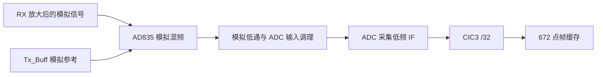
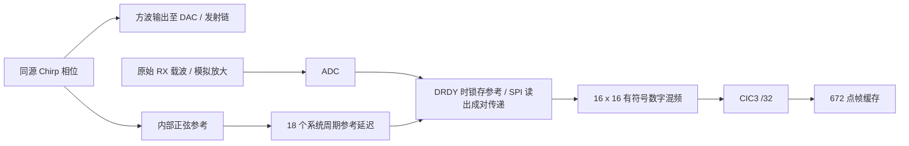

# Main workflow review — 2026-11-01

本目录属于 **`main` 模拟混频分支**。正确输入为前端 AD835 混频后的低频信号。

本次检查确认：在使用正确模拟输入通路、信号未过载且目标拍频处于搜峰范围的条件下，当前连接及处理顺序合理，未发现新的阻塞性连接或帧调度问题。这个结论是代码和已有验证证据的审查结论，不是“所有距离已经实板通过”。本次不修改 RTL、SOF、上位机 EXE 或测距参数。

## 两个版本的输入不能混用

| 项目 | `main`：模拟混频 | `fpga-mixer`：数字混频 |
|---|---|---|
| 默认发射 | 正弦 Chirp | 方波 Chirp，同时生成内部正弦参考 |
| 混频位置 | 前端 AD835 | FPGA `MainDigitalMixer` |
| 前端 P4 跳帽 | **1–2：Mixer / Rx_Mix** | **2–3：Amplifier / Rx_Amp** |
| 主板 ADC 接收 | 模拟混频后的低频 IF | 接收放大后的原始约 38–42 kHz 载波 |
| 主板约 15 kHz 模拟低通 | 默认启用，GUI `RxMuxSel=4` | 强制旁路，GUI `RxMuxSel=0` |
| 参考来源 | 实际 `Tx_Buff` 模拟电压 | 同一相位发生器的数字正弦，取自方波转换之前 |
| 模拟保护与输入调理 | 仍然需要 | 仍然需要；数字混频不能修复 ADC 前削顶 |

这里的 P4 是**前端板的三针跳帽**，不是主板 TX BNC。主板 TX → 前端 TX 输入，前端 RX 输出 → 主板 RX；详细硬件标识见工程根目录 `HARDWARE_WIRING_NOTES.txt`。切换版本时应使用对应分支的 Main SOF 和上位机。没有读取板上版本信息，不能仅根据本地文件就认定实际板上已经运行该版本。

旧版路径：



新版路径：



## 默认参数及实际处理顺序

- TX：40 kHz 中心、4 kHz 带宽，即 38–42 kHz；20 ms；幅度系数 0.25。
- RX：TX 起点后延迟 1 ms，采集 19 ms。该 1 ms 是采集窗口偏移，不会使新版参考重新从 Chirp 起点开始。
- 系统/DAC 时钟：165 MHz；ADC 时钟：27.5 MHz；ADC 数据率：165 MHz /144 = 1.145833 MS/s。
- 数字混频始终位于降采样前。CIC3 滤波并 /32，得到 35.807291667 kS/s。
- FFT 有效数据 672 点，去帧均值、乘 Kaiser β=4 窗，再补 352 个零形成 1024 点实数 FFT。
- FFT 原始频点间隔 34.968058 Hz。名义搜峰范围 25–2000 Hz，对应实际候选格点 bin 1–57。
- 功率 `Re²+Im²`；最大功率搜峰；三点对数抛物线插值，偏移限制 ±0.5 bin。当前未使用 CZT。
- 插值频率、温度补偿声速及距离由 FPGA 计算，经 M4 报文发送。没有完成绝对距离零点标定。
- 原始波形回传独立每 4 个 ADC 样点保留 1 点，典型 5442 点；不是用这 5442 点进行 FPGA FFT。

| 阶段 | 当前实现 |
|---|---|
| 新版 RX × 正弦参考 | 每个有效 ADC 样点一组，输入寄存 → 32 位乘积 → 舍入/缩放/饱和，三级寄存流水 |
| CIC3 /32 | 与采集并行，逐点处理 |
| 帧缓存 | 逐点写入，累加帧总和，收齐 672 个有效点后通知 FFT 时钟域 |
| 去均值、Kaiser 加窗 | 收齐后读取缓存，逐点处理；未配置 672 个并行窗口乘法器 |
| FFT | 加窗及补零完成后进行帧内蝶形计算，不是从 ADC 直接流入的全流水 FFT |
| 功率、最大值 | FFT 频点输出时逐点计算、更新最大峰 |
| 插值和距离 | 最终峰确定后完成；不能纠正已经选错的物理峰 |

当前没有多帧采集与 FFT 双缓冲连续重叠。FFT 帧可以在 672 点收齐时启动，不需要等待全部原始 UART 数据发送结束。计算和报文传输所耗的时间影响刷新速度，不直接作为声学传播时间加入距离。

## 新版参考对齐的保证和限制

当前源码中 `MF_REFERENCE_DELAY_CYCLES=18`；`Simulation/FFT/main_settings.json` 的 `reference_extra_delay_cycles=0`。`configure_main.py` 生成 `18 + extra`。18 个 165 MHz 周期约为 0.109091 μs，即 3 个 ADC 接口时钟周期，用于当前 DRDY 同步/捕获时序的数字配对。

ADC 驱动检测 DRDY 后保存 `pending_reference`，开始 SPI 读取时转存为 `active_reference`，输出 ADC 字时同时输出该参考。跨时钟域时保存和传递这对数值。没有在 SPI 读完后使用已经变化的即时参考，也没有把声学回波延迟对齐消除。

这仅验证了数字配对。DRDY 是数据就绪时刻，不是 ADC 模拟输入的等效采样时刻。ADS127L21 内部滤波、DAC、模拟接收通路和换能器的有效相对延迟尚未实测标定；不能把第一次转换等待时间直接等同于连续信号的群延迟。参考是内部数字模型，不是另一个 ADC 对真实 TX 输出的测量。

对线性扫频，斜率 S=4000 Hz/20 ms=200000 Hz/s。正常拍频方向下，混频前残余相对延迟 Δτ 导致 Δf=SΔτ、ΔR=cΔτ/2。以 c=343 m/s 为例，10 μs 对应约 2 Hz /1.715 mm。固定额外延迟通常造成整体偏移，不能直接解释个别距离突然换峰。混频后相同数据的运输/FFT 计算延迟不等同于该 Δτ。

参考补偿当前是编译常量，修改配置后需要生成参数并重新编译 Main。只能补偿测量确认的固定电子延迟；不得按未知目标距离把真实声学往返延迟消除。

## 验证证据

- 旧版 SourceCode 共 150 个文件：146 个与基础构建快照一致；其余 4 个逐字节匹配 2026-10-21 TemperatureRange 发布清单。当前 SOF 和 GUI EXE 也匹配该发布清单。
- 旧版目录中未纳入 Git 的完整 `.fit.rpt` 属于较早基础构建，不能用它代替当前发布的时序记录。本次采用与发布清单匹配的 SOF、`.sta.rpt`、`.sta.summary`、`.fit.summary` 和 `build_checks.json`。
- 已保存的 84 项时序检查通过，最小裕量 +0.044 ns；不是本次重新编译。
- 2026-11-01 重新运行当前 GUI 的离线自检通过：设置包、完整 5442 点解析、异常/校验恢复、M2/M3/M4、搜峰范围及 CSV 导出。
- [已有范围/温度验证](../FFT/TemperatureRange_20261021/report.html)、[已有 10–75 cm 理想距离扫描](../FFT/Search2k_20261021/report.html)。

本次没有重新跑全部 27 点声学模型，也没有重新综合布局布线；保存的时序通过记录及 SOF 哈希已复核。理想输入仿真未覆盖真实换能器频响、模拟群延迟、噪声、多径和过载，不能用于声称“实物所有距离无误差”。

## 尚未解决的实板问题

旧版实际距离单位为 cm、测量结果为 mm。此前 12.5 cm 和 15 cm 的异常不能由当前理想模型通过来排除；模拟接收增益、AD835 输入范围、偏置、多径、串扰和最大峰切换仍需对应旧版实测波形检查。

新版 2026-10-29 原始 RX CSV 的 ADC 削顶证据只属于新版采集，不是旧版异常原因已经确诊。参见 [旧版低频异常分析](../LowFrequencyAudit_20261028/report.html)。

## 复核入口

```text
python verification/WorkflowAudit_20261101/verify_release.py
```

该命令只读检查当前 SourceCode、Main SOF、GUI EXE 的 SHA256 是否匹配本目录 `checks.json`，不启动串口、不烧录、不改参数。`checks.json`、`software_selftest/` 和本分支的可用 RTL 日志记录了本次检查结果。以后修改源代码后，本快照检查会失败；应重新验证并建立新的日期记录，不能把旧快照当新验证。

## 主要依据

- [Main 顶层](../../02_RTL/V0/SourceCode/UsMimoTestBench.vhd)
- [ADC、CIC 与新版数字乘法模块](../../02_RTL/V0/SourceCode/RxAcquisition.sv)
- [帧缓存调度、FFT、搜峰与插值](../../02_RTL/V0/SourceCode/FftPipeline.sv)
- [Main 参数](../../02_RTL/V0/SourceCode/MainSettings.vhd)
- [AD835 数据手册](https://www.analog.com/media/en/technical-documentation/data-sheets/ad835.pdf)
- [ADS127L21 数据手册](https://www.ti.com/lit/ds/symlink/ads127l21.pdf)
